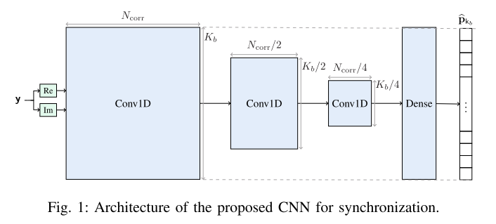
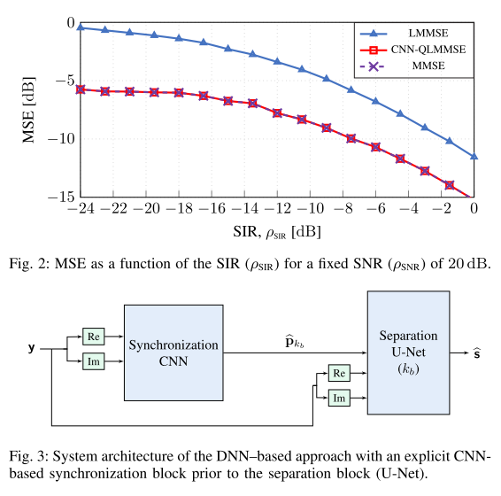
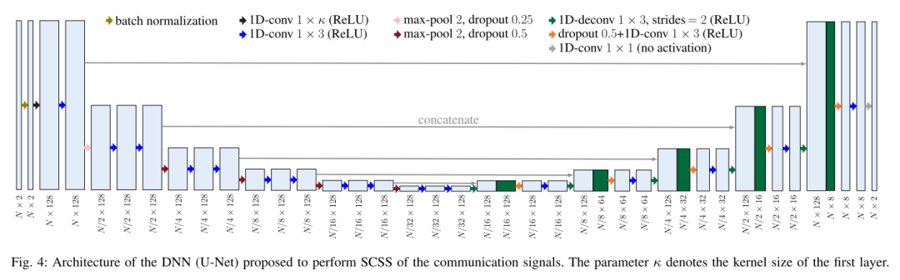
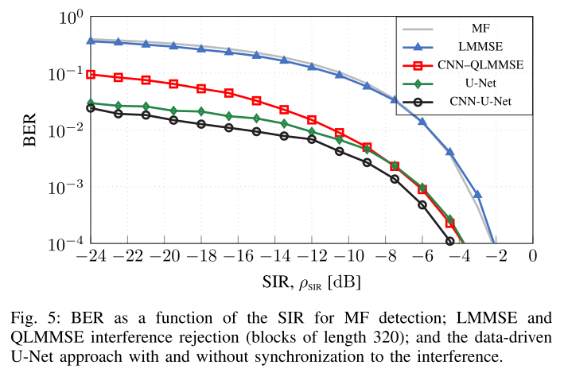
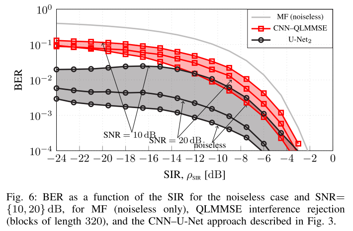

# [Synchronization + Interference Reduction] Data-Driven Digital Communication Signal Blind Synchronization and Interference Reduction [with code]

Introduction: The surge in wireless devices has led to increasingly congested radio spectrum, making spectrum sharing inevitable. Consequently, different wireless communication systems will coexist within the same frequency band, leading to unintentional interference between them. To maintain high reliability, separating overlapping signals from mixed signals received is a fundamental component of this communication system.
In the fields of image and audio, machine learning techniques have been successfully applied for source separation, such as in [3] document file separation. These methods often leverage domain knowledge related to signal structure. For example, color features and local dependencies are useful for separating natural images, while time-frequency spectrogram masking methods are commonly used for audio signal separation.
For communication signals, if the source is separable in time or/and frequency, they can be separated using appropriate masking and classical filtering methods (see e.g., [6]). A key challenge in this field is when receivers are equipped with a single antenna, the separation of overlapping signals in time and frequency inherently implies no spatial diversity to exploit. This problem is also known as Single Channel Source Separation (SCSS). In this case, standard blind source separation methods that utilize spatial diversity, such as [7], [8], are irrelevant.
Various methods are available in literature for performing SCSS on digital communication signals. A common approach is the maximum likelihood sequence estimation of target signals, which can be implemented using particle filters and algorithms like survivorship processing [9]. However, such methods require prior knowledge of the signal model, which may be unknown or unavailable in practice.
Perhaps a more realistic approach is to assume only the dataset of underlying communication signals is available. This can be achieved by direct/background recordings or using high fidelity simulations (e.g., [11]) allowing data-driven approaches. In this context, deep neural networks (DNN) are a natural choice. This problem was recently extended by the "RF Challenge" [12].
This paper investigates the data-driven SCSS problem, where two communication signals overlap in time and frequency, and the receiver is equipped with a single antenna. We prioritize generating the interested signal of interest (SOI) known from the generation process and the interfering signal with unknown circular statistical characteristics - just like in standard protocols. This problem is also known as interference suppression. As performance metrics, we consider the bit error rate (BER).
Contribution: We show that time-nonstationary signals constitute strong conditions for better separation. Specifically, when such temporal structure exists, the concept of (time) synchronization not only becomes reasonable but also facilitates separation. Based on our theoretical results combining synchronization with MMSE optimal separation, we propose a data-driven DNN method whose BER outperforms classical demodulation methods with matched filtering (MF) and interference suppression along with SOI's linear minimum mean square error (LMMSE) estimation. Our proposed DNN architecture can include explicit synchronization, inspired by specific domain knowledge related to digital communication signals.
Article illustrations
Conclusion: We study the SCSS problem focusing on its anti-interference applications in digital communications. For Gaussian signals, we demonstrate that a decoupled system structure's synchronization separation is asymptotically optimal in the MMSE sense. Therefore, since the best system might be impractical for implementation purposes, we propose a computationally attractive alternative, where the performance loss relative to the best system can be ignored. For (non-Gaussian) signals, we prove in simulation that the proposed data-driven method based on DNN can exploit the underlying temporal structure of the signal, thereby achieving significant gains in BER, especially superior to classical methods. The extension of this work should focus on understanding how and when explicit synchronization can be used in the context of SCSS and DNN.

## Images

<!-- PAYMENT_BLOCK -->

## Get this dataset

- Payment link (Stripe): [Buy now](https://buy.stripe.com/3cs8yP7sY87d0vu9AB)
- Payment QR code: 

<!-- /PAYMENT_BLOCK -->
